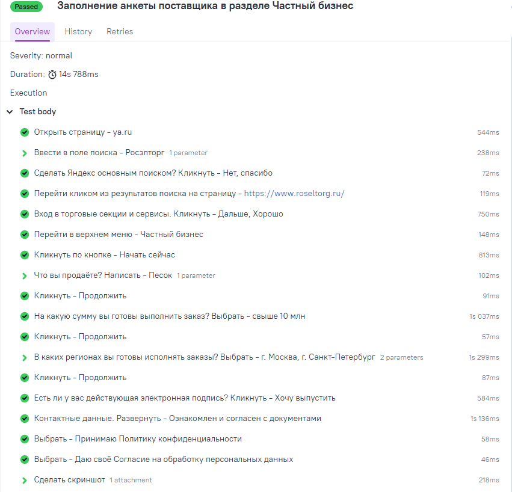
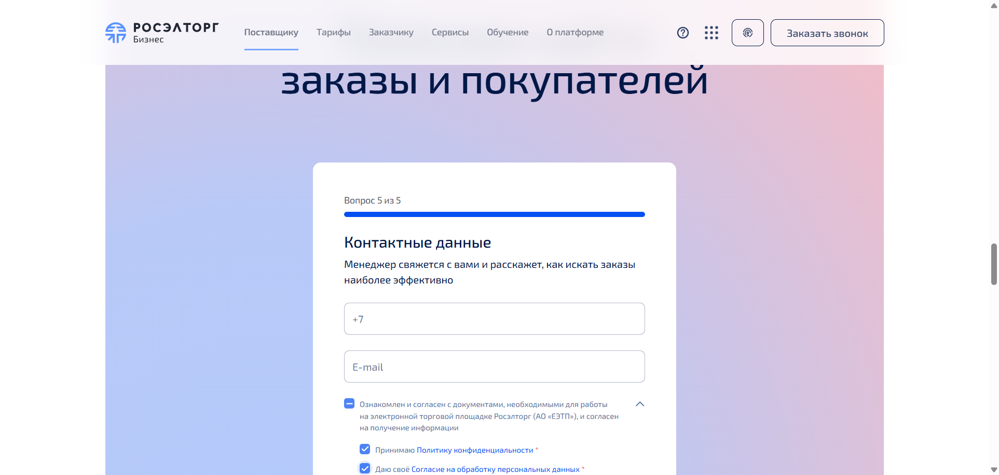

# Тестовое задание Росэлторг: автотест анкеты поставщика

## Задание

Требуется написать автотест (стек: java + selenium + Junit5 + maven)

- Открыть страницу ya.ru
- Ввести в поле поиска "Росэлторг"
- Перейти на страницу https://www.roseltorg.ru/ кликом (из пунта в результате поиска, обычно выходит первым)
- Перейти "Частный бизнес" (пункт в верхнем меню)
- Кликнуть по кнопке "Начать сейчас"
- На вопрос "Что вы продаёте?" написать "Песок"
- Кликнуть "Продолжить"
- На вопрос "На какую сумму вы готовы выполнить заказ?" выбрать свыше 10 млн
- Кликнуть "Продолжить"
- На вопрос "В каких регионах вы готовы исполнять заказы?" выбрать "Москва" и "Санкт-Петербург"
- Кликнуть "Продолжить"
- На вопрос "Есть ли у вас действующая электронная подпись?" кликнуть "Хочу выпустить"
- На вопрос "Контактные данные" не отвечать, развернуть "Ознакомлен и согласен с документами"
- Выбрать "Принимаю Политику конфиденциальности *" и "Даю своё Согласие на обработку персональных данных *"
- Сделать скриншот

Плюсом будет оформление результата в Allure-отчёт

## Стек

Java 17, Maven, Selenium 4.52, JUnit 5.14, Allure 2.35

## Отчёт Allure

[allure-report.html](docs/allure-report.html)

## Скриншот результата

